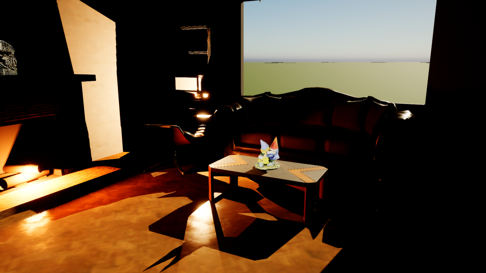

# UE5Splats

The home of **SplatPak**, an Unreal Engine 5 plugin that renders compressed 3D Gaussian splat scans (`.gstx` packages) inside
Unreal's own renderer, so they sit in a level next to Nanite meshes and occlude them correctly.
It's a port of the DirectX 12 renderer in [splatpak](https://github.com/dewilkinson/splatpak).

> **Status: early development (step 1 of 5).** The `.gstx` loader and its tests pass; the Unreal
> side is being brought up on UE 5.8 and hasn't been seen rendering yet. See
> [docs/plan.md](docs/plan.md) for exactly what's verified and what's next.

## What's here

| Path | Contents |
|---|---|
| [Plugins/SplatPak/](Plugins/SplatPak/) | The plugin: `.gstx` import, a placeable Splat Actor, and the GPU passes (mesh shaders by default, vertex-shader fallback). See its [README](Plugins/SplatPak/README.md). |
| `PluginSandbox.uproject`, `Source/`, `Config/` | A minimal host project for building and testing the plugin. |
| [Scripts/](Scripts/) | `BuildCodec.ps1`, `Build.ps1`, `Test.ps1`, `Package.ps1`. |
| [docs/](docs/) | The design record: the decision log, the plan with step status, and a dated journal. |

## Requirements

- Windows 10/11 x64 and a DirectX 12 GPU. Mesh Shader Tier 1 is used where available; older GPUs
  use the fallback path.
- Unreal Engine 5.8 (from the Epic Games Launcher).
- Visual Studio with the "Game development with C++" workload and the Windows SDK, using an MSVC
  toolset UE 5.8 supports (14.44 from VS 2022 17.14, or 14.50 from VS 2026). See the codec
  section for a toolset caveat.
- Git LFS.

## The codec

`.gstx` packages are compressed by the **GSTx codec library**, which is **not part of this repository and
not covered by its licence**. The plugin links it as a prebuilt static library:

```powershell
git lfs install
git clone https://github.com/dewilkinson/splatpak.git C:\github\splatpak
.\Scripts\BuildCodec.ps1 -CodecRepo C:\github\splatpak
```

This copies splatpak's prebuilt codec library and headers into
`Plugins/SplatPak/Source/ThirdParty/GSTx/`. That folder is gitignored. The prebuilt
library is distributed under its own binary licence
(`libs/gstx/prebuilt/LICENSE.txt` in splatpak).

If the prebuilt library isn't available, the script builds splatpak's open stand-in sources
instead. The stand-in codec can't decode packages written by the real codec, so use the
prebuilt library to load the sample scans.

> **Known issue: toolset mismatch.** splatpak's current prebuilt library was compiled with MSVC
> 14.51, and a static library has to be linked with the same MSVC version or a newer one. Linking
> it with 14.44 (VS 2022) fails with `unresolved external symbol __std_rotate`; 14.50 is older
> than 14.51 too, so expect the same there. Until the prebuilt library is rebuilt with an older
> toolset, the plugin only links against a codec built from source with your own toolset.

## Building and testing

```powershell
.\Scripts\Build.ps1                 # stages the codec if needed, then builds the editor target
.\Scripts\Test.ps1 -Filter SplatPak  # automation tests, headless
```

Then open `PluginSandbox.uproject`, drag a `.gstx` (for example from splatpak's `assets/`) into
the Content Browser, place a **Splat Actor** and assign the imported asset.

## Licence

Apache License 2.0; see [LICENSE](LICENSE). This covers the plugin, project and scripts in this
repository. It does not cover the GSTx codec library, which has its own terms.

## Demo scene



`.\Scripts\BuildLivingRoom.ps1 -Sandbox` builds a furnished living room into this repository's
PluginSandbox project (`/Game/LivingRoom/Map_LivingRoom`): a brick fireplace with glowing embers, a
lounge chair, sofa, coffee table, shelves and lamps as Nanite meshes, with the dwarves scan standing on
the coffee table and the Cthulhu statue on the mantel. Everything in it is free to use:

- The furniture and textures are CC0 models from [Poly Haven](https://polyhaven.com), downloaded into
  `ThirdPartyAssets/` on first run.
- The splat scans are the CC BY 4.0 sample packages bundled with
  [splatpak](https://github.com/dewilkinson/splatpak) (`assets/dwarves`, `assets/cthulu`; their
  `LICENSE.txt` files credit the authors). Clone splatpak beside this repository, or pass
  `-Samples <path to its assets folder>`.

The built level is not committed (about 200 MB of imported assets); the script rebuilds it in a few
minutes and always matches the current plugin. `.\Scripts\OpenDemo.ps1 -Project PluginSandbox.uproject -Map /Game/LivingRoom/Map_LivingRoom`
opens it in the editor. Without `-Sandbox` the script builds into a project beside this repository
(see `Scripts/FindDemoProject.ps1`) under `/Game/Demo`.
